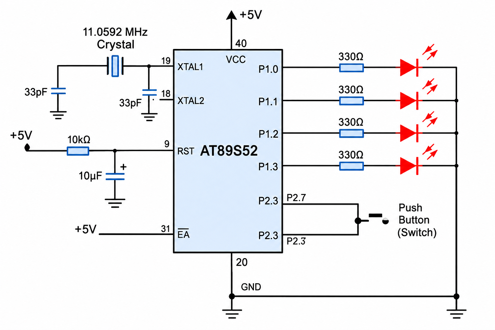

# EXPERIMENT DETAILS

**EXP:** CONTINUOUS ASSESSMENT 3

**DATE:** 27/07/2026

**NAME OF EXP:** Timer-Based LED Pattern Generator and Button Interrupt Controller

**HARDWARE SETUP / PLATFORM:** 8051 Microcontroller (AT89S52) + Keil µVision (Keil C51 Compiler)

---

## TASK: Register-Level Four-State LED Control System

### 1. Circuit Diagram

AT89S52 development board configured with four LEDs connected to four GPIO output pins and one push-button switch connected to a GPIO input pin.

**Circuit Diagram:**

### 2. Hardware Setup & Operating Modes

| Parameter | Student Entry |
|---|---|
| MCU | AT89S52 |
| CPU Core | 8-bit 8051 |
| Operating Voltage | 5V |
| Debug Interface | Multimeter / Programmer interface (board-dependent) |
| Output Peripherals | 4 LEDs (Digital Outputs) |
